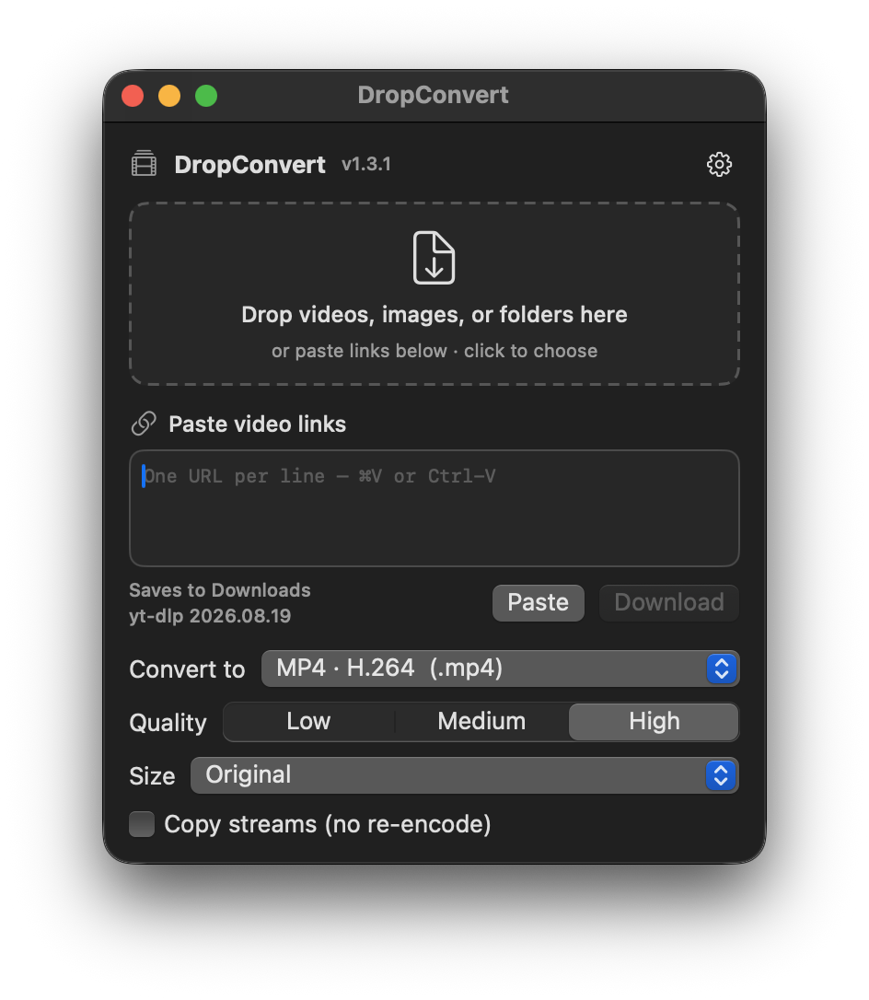
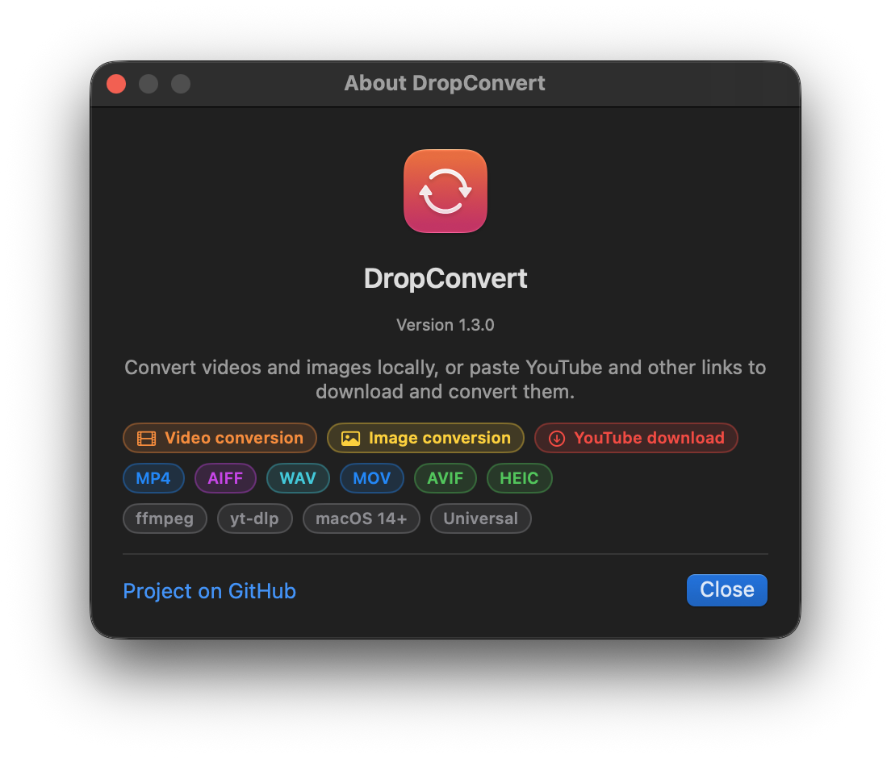

# DropConvert

<p>
  
  
  
  
  
  
  
  
  
  
  
  
  
</p>

A small macOS app: drop a video, image, or folder on its menu-bar icon (or into its window) and it converts the media to
the format you picked, using ffmpeg. You can also paste a list of video links — YouTube and other yt-dlp sites — to
download and convert them. Results land beside the original, in a folder you choose, or in Downloads for links.



The app also has a Dock icon and a regular window with the same controls. If macOS hides the menu-bar item because
the menu bar is full, the window opens instead; reopen it from the Dock icon or the DropConvert menu.

## Download

- **GitHub release:** [latest macOS build](https://github.com/BobClawblaw/dropconvert/releases). Each DMG ships with a
  SHA-256 checksum.
- **Homebrew:** trust the tap once, then install:

  ```sh
  brew trust bobclawblaw/tap
  brew install --cask bobclawblaw/tap/dropconvert
  ```

  Updates come with `brew upgrade --cask dropconvert`.

The GitHub build is ad-hoc signed unless a Developer ID identity is configured. On macOS 15 and later, if macOS blocks
the app, open **System Settings → Privacy & Security**, scroll to the message about DropConvert, and click **Open
Anyway**. (The old right-click → Open shortcut no longer overrides Gatekeeper.) Homebrew installs usually avoid the
prompt, but if macOS still blocks one, use the same Open Anyway flow.

Verify a download with:

```sh
shasum -a 256 -c DropConvert-1.3.2.dmg.sha256
```

The `.sha256` asset on the release page uses the DMG's file name, so `-c` works after downloading both files into the same folder.

## Features

- Convert local videos, still images, animated GIFs, and audio between the formats listed below.
- Drop folders to convert every supported file inside them, recursively.
- Paste one or many links to download with yt-dlp, then convert to any selected format.
- Use cookies from Safari, Chrome, Firefox, Edge, Brave, or Chromium for age-restricted, members-only, and
  "confirm you're not a bot" videos.
- Download full playlists, optionally embed English subtitles, and update yt-dlp from the gear menu.
- Pause the queue, change a job's format before it runs, reorder or remove jobs, and retry failures.
- Unfinished jobs are saved and restored after a quit or crash.
- Cancel stops the whole process tree, including yt-dlp's ffmpeg merge child.
- If "Copy streams" fails because the codecs don't fit the container, the app automatically retries with a re-encode.
- Preflight checks catch missing audio/video streams, an unwritable output folder, and low disk space.
- **gear menu → Copy diagnostics** collects tool paths, versions, settings, and recent errors for bug reports.

## Formats

| Kind | Formats |
|---|---|
| Video | MP4 (H.264, HEVC, AV1), MOV (H.264, HEVC, ProRes 422), M4V, MKV (H.264, HEVC), WebM (VP9, AV1), AVI (MPEG-4 Part 2), MPG (MPEG-2), MPEG-TS, FLV, 3GP, WMV, OGV (Theora) |
| Still image | JPG, PNG, WebP, AVIF, HEIC, TIFF, BMP, QOI |
| Animated image | GIF (two-pass palette) |
| Audio only | MP3, M4A (AAC, ALAC), WAV, AIFF, CAF, OGG Opus, FLAC |

Only formats your ffmpeg build can encode are listed. AVIF and HEIC are written with macOS ImageIO instead of ffmpeg;
for a video source, the first frame is used. Homebrew's ffmpeg build currently has no libwebp encoder, so WebP stays
hidden unless you install an ffmpeg build that includes it.

## Links

Paste links into the "Paste video links" box in the app — one per line, or separated by spaces, commas, or semicolons —
then press Download. YouTube variants (`youtu.be`, `/shorts/`, `/embed/`, `/live/`) are normalized and duplicates are
collapsed.

- **Cookies:** gear menu → Cookies for sign-in. Safari may ask for Full Disk Access the first time.
- **Playlists:** gear menu → Download full playlists. Each item is downloaded and queued as its own conversion.
- **Subtitles:** gear menu → Embed English subtitles. This applies to video outputs.

Downloads are staged in a temporary folder and removed when the conversion finishes, fails, or is cancelled. Converted
links go to your chosen output folder, or to Downloads when no folder is set. They are named after the video title and
numbered when a file with that name already exists. Titles longer than the filesystem limit are truncated safely.

## Options

- **Quality:** Low / Medium / High, mapped to each encoder's own scale (CRF for x264/x265/VP9/AV1, `-q:v` for
  VideoToolbox and the MPEG-family encoders, profile for ProRes, bitrate for audio, compression quality for AVIF/HEIC).
  Lossless formats (PNG, TIFF, BMP, QOI, WAV, AIFF, CAF, FLAC, ALAC) have no quality setting.
- **Size:** Original, 2160p, 1080p, 720p or 480p — the longest side, which is never upscaled. For video, odd
  dimensions are trimmed to even ones so 4:2:0 encoders accept them; still images keep odd sizes (lossless formats)
  unless a smaller target is chosen.
- **Copy streams (no re-encode):** remuxes into the new container. It's fast and lossless, but it fails when the codecs
  don't fit the container (H.264 into WebM, say). DropConvert automatically retries with a re-encode if that happens.
- **Hardware encoder (gear menu):** uses VideoToolbox for H.264, HEVC and ProRes. It's on by default and much faster;
  turn it off for libx264/libx265, which give smaller files at the same quality.
- Gear menu: output folder, show in Finder when done, launch at login, cookies, playlists, subtitles, update yt-dlp,
  copy diagnostics, About.

Jobs run one at a time, in the order they were added. Each one shows download speed/ETA or conversion progress and can
be paused, cancelled, retried, moved, or have its output format changed. A failed or cancelled job leaves no partial
file. Existing files are never overwritten: `clip.mp4` becomes `clip 2.mp4`. DropConvert is also registered as an
"Open With" app for videos and images in Finder, and accepts dropped links.

## Requirements

- macOS 14 or later
- ffmpeg (`brew install ffmpeg`). DropConvert looks in Homebrew, MacPorts, common user bin folders, `PATH`, and finally
  your login shell, so tools installed with pipx or asdf are found too.
- yt-dlp (`brew install yt-dlp`) to download links.
- Xcode command-line tools with Swift 5.10 or later, to build

## Troubleshooting

- **YouTube asks you to sign in:** gear menu → Cookies for sign-in, pick the browser you use, then retry. Updating
  yt-dlp from the gear menu also helps.
- **A download fails with 403 or "requested format is not available":** update yt-dlp and try a different size.
- **The app says ffmpeg isn't found:** install it with Homebrew, then use gear menu → Check for ffmpeg and yt-dlp. If
  it's installed somewhere unusual, make sure your login shell can find it (`command -v ffmpeg`).
- **A conversion fails:** open the job's **Details** sheet to see the full ffmpeg/yt-dlp output, or copy diagnostics
  from the gear menu.
- **Gatekeeper blocks the app:** see the Download section above.

## Build

```sh
swift build --disable-sandbox
swift test --disable-sandbox
./scripts/build-app.sh            # builds build/DropConvert.app (ad-hoc signed)
./scripts/build-app.sh --install  # also copies it to /Applications and launches it
./scripts/build-dmg.sh            # builds build/DropConvert-<version>.dmg and its .sha256
./scripts/release.sh              # builds and publishes a GitHub release for version.txt
```

The version lives in `version.txt`; the build scripts substitute it into `Resources/Info.plist`. The app icon
(`Resources/AppIcon.icns`) is generated by `scripts/make-icon.swift`. Delete the file to regenerate it.

CI runs `swift build`, `swift test`, and an app build on every push and pull request. Pushing a `v*` tag runs the
release workflow, which builds the DMG, writes the checksum, and publishes the GitHub release.

### Signing and notarization

`scripts/build-app.sh` and `scripts/build-dmg.sh` use a Developer ID Application identity when one is available
(`DEVELOPER_ID` or the keychain), and fall back to ad-hoc signing. Set `NOTARIZE=1` plus `APPLE_ID`, `APPLE_TEAM_ID`,
and `APPLE_APP_PASSWORD` to submit and staple the app/DMG with `notarytool`.

## About

DropConvert is a macOS menu-bar app with a Dock icon and a window fallback. It converts local media with ffmpeg and
ImageIO, and downloads YouTube, Vimeo, and other yt-dlp-supported links before converting them. The About window —
available from the app menu or the gear menu — shows the version and feature pills.



## License

MIT
